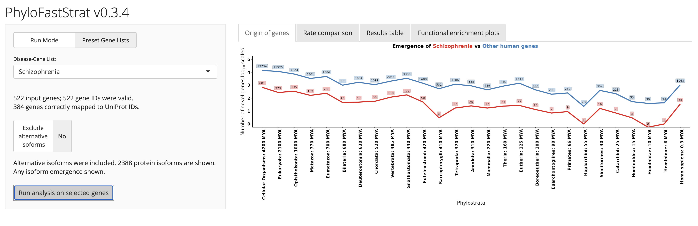

# PhyloFastStrat

An interactive Shiny app for exploring the evolutionary origins of disease-associated genes. Maps any set of human genes onto a phylostratigraphic timeline, tests for enrichment in each phylostratum, and runs GO biological process over-representation analysis at each evolutionary stratum.

**Live app:** [rishabhaldar.shinyapps.io/PhyloFastStrat](https://rishabhaldar.shinyapps.io/PhyloFastStrat/)

---

## For users

You don't need to install anything. Open the link above in any web browser — Chrome, Safari, Firefox, Edge all work. The app also runs on phones and tablets, though the plots are easier to read on a laptop.

**First load is slow.** The app sleeps when nobody's using it, so the first person to open it after a quiet stretch waits ~10–20 seconds while it wakes up. Subsequent loads are instant. If you see a blank screen, give it a moment.

### How to use it

1. **Pick a gene list.** The default mode ("Preset Gene Lists") gives you a dropdown of curated disease gene sets. Flip the "Run Mode" toggle to "Custom Gene Lists" to either paste in your own genes or upload a one-column CSV.
2. **Click "Run analysis on selected genes."** The four tabs along the top will populate:
   - *Origin of genes* — a line plot showing how many genes from your list emerged at each evolutionary stratum, compared to the rest of the human genome. Click a point on the plot to see exactly which genes emerged at that stratum.
   - *Rate comparison* — odds-ratio enrichment of your gene list per stratum. Asterisks mark FDR-adjusted Fisher p-values < 0.05.
   - *Results table* — sortable, exportable table of every gene in your list and the stratum where it appeared. Use the buttons at the top to download as CSV or Excel.
   - *Functional enrichment plots* — GO biological process over-representation in your gene list, split by stratum. Click a stratum's column to drill into its top terms.
3. **Download anything you want to keep.** The Results table has CSV/Excel/copy buttons; the GO plot has a "Download GO Table" button.

### If it breaks

Refresh the page (Cmd/Ctrl + R). 90% of the time that fixes it. If it still doesn't work, [open an issue on GitHub](../../issues) or contact the maintainer.

---

## What PhyloFastStrat does

The pipeline behind the app, briefly:

- Every human protein is assigned a **phylostratum** — the most recent common ancestor in which a homolog can be detected — using [`phylostratr`](https://github.com/arendsee/phylostratr) with BLAST against a panel of representative species. Detection uses an adjusted p-value cutoff of 0.001.
- For a given user gene list, the app counts how many genes fall in each stratum and tests enrichment per stratum with **Fisher's exact test** on a 2×2 contingency table (disease vs. complement × in-stratum vs. out-of-stratum), with Benjamini-Hochberg FDR correction across strata.
- GO biological process **over-representation** is run separately within each stratum using `topGO`'s classic Fisher algorithm against the full GO-annotated human gene universe. Fold enrichment is reported as observed / expected gene counts.

By default, the application retains alternative UniProt entries. Selecting 'Exclude alternative isoforms' assigns each mapped gene a single phylostratum based on its earliest-emerging entry. Gene-level enrichment analyses should use this setting.

Gene Ontology biological-process enrichment is evaluated against the annotated human gene background. The primary GO visualization displays unadjusted p-values; adjusted values are available in the detailed results.

## Methods decisions and validation

Several analytical choices were revised after auditing earlier versions of the app:

- **Over-representation, not ranked GSEA, for GO enrichment.** Version 0.3.2a passed fgsea a vector containing only the genes of interest, all scored 1. With no ranking across the gene universe, the resulting p-values weren't interpretable. Since 0.3.3, enrichment uses topGO's classic Fisher test against the full GO-annotated human gene universe, the standard approach for asking whether a gene set is over-represented in a term.
- **Joining evolutionary dates by name, not row order.** Divergence times were originally attached to phylostrata by position in the reference table, which silently mislabels strata if the file is reordered. They're now matched by taxon name, and the app warns at startup if any stratum lacks a date. This check caught three spelling mismatches in the reference table (Haplorrhini, Homininae, Cellular organisms).
- **Clear comparison groups.** The per-stratum enrichment test is a 2×2 Fisher's exact test of the gene list against its complement in the human proteome, with Benjamini-Hochberg correction across strata. The emergence plot labels the comparison line "Other human genes" so the two curves aren't mistaken for overlapping sets.
- **Divergence times.** Stratum dates are approximate literature estimates; the root (cellular organisms) is set at 4,200 million years ago, consistent with recent estimates for the last universal common ancestor.

---

## For developers

### Run locally

1. Clone the repository:

```bash
git clone https://github.com/RishabHaldar/PhyloFastStrat.git
cd PhyloFastStrat
```

2. Install the exact package versions used by the app (one-time; may take a while because of the Bioconductor packages):

```r
install.packages("renv")
renv::restore()
```

3. Run the app:

```r
shiny::runApp()
```

Or open `app.R` in RStudio and click **Run App**.


### Repository layout

```
PhyloFastStrat/
├── app.R                              # Shiny app
├── deploy.R                           # One-line redeploy helper
├── renv.lock                          # Pinned package versions (R 4.4.2, Bioconductor 3.20)
├── data/
│   ├── ph_0.001.rds                   # Phylostratigraphy result table
│   ├── uniprot_gene_conv_df_updated.rds  # UniProt ↔ gene symbol map
│   └── Final_Taxa_Emergence_Timeline_with_Cellular_Organisms.csv  # MYA per stratum
├── images/
│   └── app_screenshot.png             # Screenshot shown in this README
├── CHANGELOG.md
├── LICENSE
├── README.md
└── .gitignore
```

`data/MasterGeneLists_fallback.rds` is not included in the repository. `app.R` reads it only if the Google Sheet cannot be loaded; without it, the app stops at startup when the sheet is unreachable.

The disease gene lists themselves are **not stored in the repo**. They live in a public Google Sheet, and the app reads them at startup via `googlesheets4::gs4_deauth()`. To use your own gene lists, either edit the master sheet (if you have access) or change `MASTER_SHEET_URL` near the top of `app.R` to point at your own sheet (which must be set to "Anyone with the link: Viewer").

### Updating the gene list

The application retrieves curated gene lists from a public Google Sheet at startup. Updates to the curated lists can be made directly in the source sheet by authorized editors. Changes are loaded when the application restarts. The optional local fallback dataset is not distributed with this repository.

---

## Version history

See [CHANGELOG.md](CHANGELOG.md).

## Citation

If you use PhyloFastStrat in your work, please cite:

> Natterson-Horowitz B, Haldar R, Sawyer D. Evolutionary Origins of Atherosclerosis: Ancient Conserved Biology Underlies Disease Vulnerability and Constrains Therapeutic Modification. *Manuscript under review at* Journal of the American College of Cardiology (JACC), 2026.

A full citation with DOI will be added here upon publication.

The underlying phylostratigraphy method is from Domazet-Lošo & Tautz (2008) and uses Arendsee et al.'s [`phylostratr`](https://github.com/arendsee/phylostratr) R package.

## License

MIT — see [LICENSE](LICENSE).
